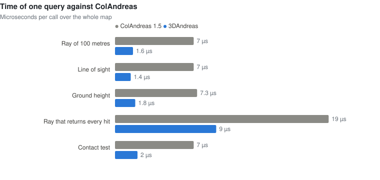
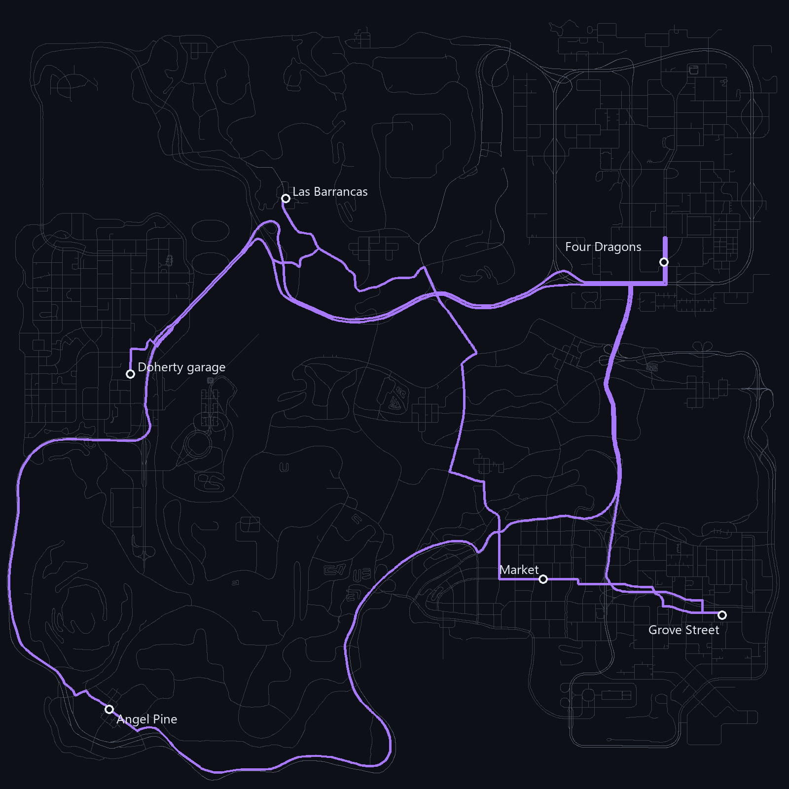
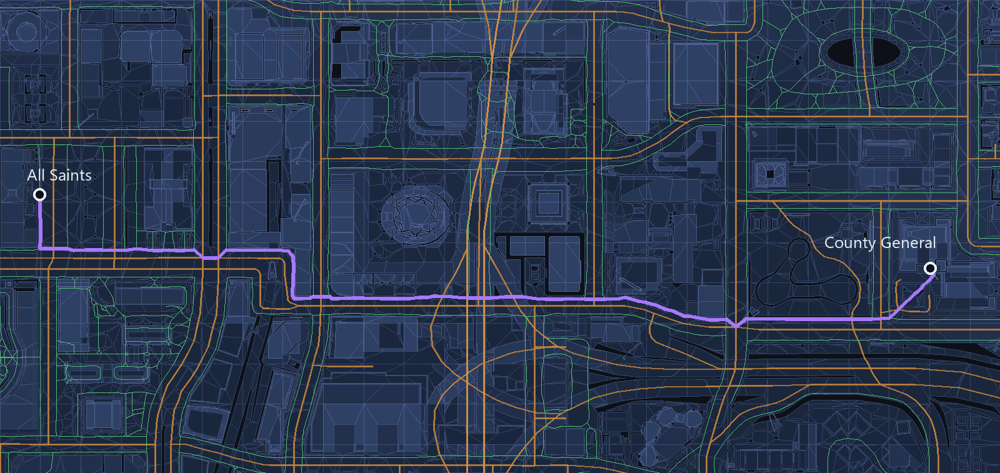
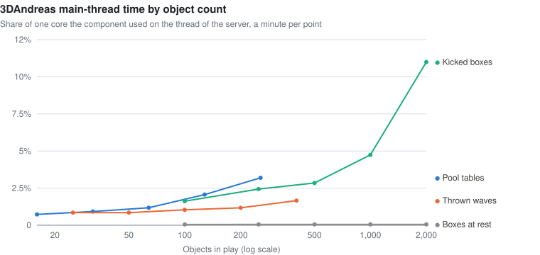
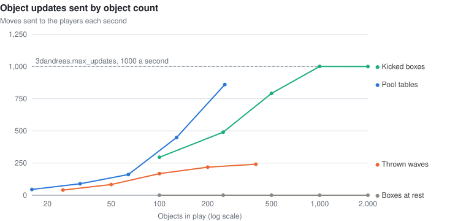
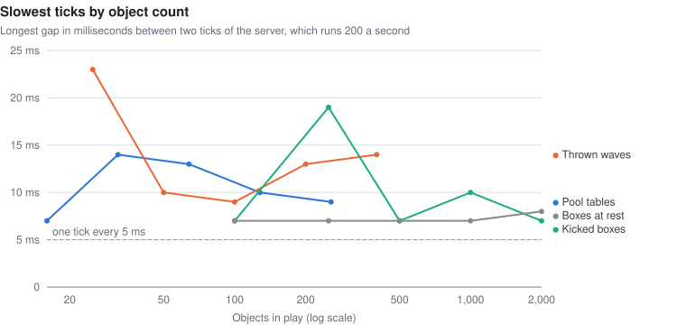
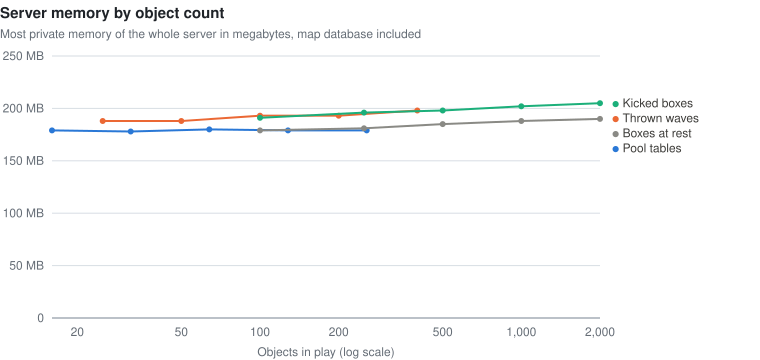

# 3DAndreas

> [!NOTE]
> 3DAndreas is experimental and already runs in production. Its natives may still change from one version to the next. It was made with Claude Opus 5.5, a model by [Anthropic](https://www.anthropic.com).

An open.mp component that simulates physics on the map of San Andreas with [Jolt Physics](https://github.com/jrouwe/JoltPhysics), answers questions about that map and finds routes across it: what a ray hits, where the ground is, whether two points see each other, what a shape overlaps, where the water lies, what a player has on screen, and the way to anywhere by road, by boat or on foot. It loads from the `components` folder, is configured in `config.json` and reads the map from a database built from the files of the game.

## Demo

[](https://youtu.be/Szcq4VUscAc)

Physics objects moved by 3DAndreas, recorded in the game on an open.mp server. The picture opens the video on YouTube.

## Features

- **Physics objects.** Spheres, boxes and objects shaped like a model fall, roll, bounce, float and push each other. Players see them as objects the component moves, with at most `max_updates` updates a second, so even a rain of hundreds of objects never floods a client. Static objects and zones never move and make walls, tables and goals.
- **Model settings.** `models.json` gives the shape, mass, friction, bounce and more to 203 models, from balls to weapons, so `A3D_CreateObject(1946, x, y, z)` makes a basketball that bounces like one. Every other model gets a mass from its volume and a friction and bounce from what its collision is made of.
- **World queries.** Rays give the point, the normal, the model and the surface of the game they hit. There are rays that return every hit, line of sight, ground height, sphere sweeps and the overlaps of a sphere, a box or a model.
- **Players, vehicles and actors.** Players on foot and actors are capsules and vehicles are boxes that move with them, so objects bounce off them and queries find them. A player pushes a pile of crates the way a person would, without throwing them. Searches in a sphere or a cone can require line of sight, and the camera of a player gives what they look at.
- **The map.** Water levels, points under water or inside the collision of the map, free spots on the ground, predicted throws, the size and the `object.dat` data of models, and building removal for every virtual world or for one.
- **The screen.** Where a point of the world shows on the screen of a player, and what a point of the screen shows, in text draw units.
- **Geometry.** The rotation that stands an object on a slope, reflections, offsets relative to objects and vehicles, the parts of a vehicle, and quaternions.
- **Routes.** The fastest or shortest way by road, keeping to the one way streets of the game, or driving them both ways for the emergency services, on the roads the traffic drives, by boat and on foot. Each route is found in some tens of microseconds by contraction hierarchies, pays for its turns, and gives its points, turn by turn directions and the progress of a player along it. One search finds the nearest of many places by road.
- **A GPS line.** A route shows on the radar and the map of a player as a line that moves on as they go, whole when it fits, drawn with gang zones sent straight to their client. The script hears when they arrive, stray, or come nearer the next turn.
- **Walking anywhere.** An optional navigation mesh of the whole map, built with [Recast](https://github.com/recastnavigation/recastnavigation), tells where a pedestrian can walk: walks from a yard to a door, random spots that can be walked to, and whether a straight walk is clear.

## Compared with ColAndreas

The same queries on ColAndreas 1.5 and on 3DAndreas, measured with [`tests/colandreas.pwn`](tests/colandreas.pwn) on one computer:

| | ColAndreas 1.5 | 3DAndreas |
| --- | --- | --- |
| Server ready after launch | 2.8 s | 0.47 s |
| Private memory of the server | 557 MB | 178 MB |
| 10,000 rays of 100 metres | 70 ms | 16 ms |
| 10,000 lines of sight | 70 ms | 14 ms |
| 10,000 ground heights | 73 ms | 18 ms |
| 1,000 rays that return every hit | 19 ms | 9 ms |
| 1,000 contact tests | 7 ms | 2 ms |



A bare server, with neither of them, is ready in 0.25 s and uses 51 MB. When rays stop at the water, as they do in ColAndreas, 113 of 120 ground heights across the map are identical and the other 7 lie within 5 mm.

## Routes



The roads and the paths of the game, from its `nodes*.dat` files, become a network of 2,304 junctions for the roads and 10,913 for the paths and roads on foot. When the server starts, a contraction hierarchy is built for each type of route on threads of their own, in about a second. A route then climbs from both ends to meet in the middle, and costs tens of microseconds across the whole map, inside the native that asks, with no thread or callback.

The same five routes found with [samp-gps-plugin](https://github.com/AmyrAhmady/samp-gps-plugin) 1.4.1 and with 3DAndreas, on the same server, with [`tests/compare.pwn`](tests/compare.pwn):

| Route | Plugin, nearest nodes and path | 3DAndreas, route with its points | 3DAndreas, length only |
| --- | --- | --- | --- |
| Grove Street to the Doherty garage | 16.8 ms | 48 µs | 14 µs |
| The Doherty garage to Four Dragons | 14.8 ms | 30 µs | 10 µs |
| Four Dragons to Angel Pine | 17.0 ms | 50 µs | 18 µs |
| Angel Pine to the Market | 13.3 ms | 30 µs | 8 µs |
| The Market to Grove Street | 12.8 ms | 29 µs | 16 µs |

Most of the time of the plugin goes to finding the node nearest to each end, 6.2 ms each. The routes of 3DAndreas also keep to the 11,524 one way links the game marks, where the file of the plugin marks 961, and start on the road beside each point rather than at the nearest node.



A walk from All Saints to County General: from the door of one hospital to the street on the navigation mesh, along the paths of the game, and across the forecourt of the other. [`examples/gps.pwn`](examples/gps.pwn) is a filterscript that makes a GPS of the routes. The [Routes](https://github.com/imshooter/3DAndreas/wiki/Routes) and [Navigation mesh](https://github.com/imshooter/3DAndreas/wiki/Navigation-Mesh) pages of the wiki tell more.

## Cost on the server

Each scenario of [`tests/stress.pwn`](tests/stress.pwn) ran for a minute on 3DAndreas 0.6.3, on one computer. The component column is the time [A3D_GetStats](https://github.com/imshooter/3DAndreas/wiki/A3D_GetStats) reports on the thread of the server, and the whole server column is the CPU the process used on all its threads, bots and network included, both as a share of one core:

| Scenario | Component, share of one core | Whole server, share of one core | Updates sent |
| --- | --- | --- | --- |
| A pool table, a shot every six seconds | 0.8% | 2.7% | 64 a second |
| Eight pool tables, a shot on each every six seconds | 1.8% | 5.6% | 405 a second |
| Waves of 100 objects thrown every ten seconds, 50 bots connected | 1.0% | 4.3% | 165 a second |
| 500 boxes in an arena, 50 kicked every two seconds, 50 bots connected | 3.1% | 9.5% | 816 a second |
| The 500 boxes at rest | 0.06% | 1.3% | none |

Objects at rest cost almost nothing, so the cost follows the objects in motion, not the objects created. The same scenarios at growing counts, a minute per point:





The 2,000 kicked boxes cost 11% of one core and stay at the limit of `max_updates`. Boxes at rest cost the same at 100 and at 2,000.



The server runs a tick every 5 ms. One tick in a thousand took 7 ms or more in nearly every run, and the longest gaps come and go with no trend as objects grow.



Memory follows the map, not the objects: 2,000 boxes add about 11 MB to a server of 180 MB.

The numbers change by about a fifth from one session to another on the same computer, so compare runs made one after the other. The [Performance](https://github.com/imshooter/3DAndreas/wiki/Performance) page of the wiki has the time of each query.

## Installation

1. Download the latest release from [Releases](https://github.com/imshooter/3DAndreas/releases).
2. Extract it into the folder of the server. It holds `components/3DAndreas.dll`, `qawno/include/3DAndreas.inc`, `scriptfiles/3dandreas/world.db`, `scriptfiles/3dandreas/models.json` and `scriptfiles/3dandreas/navmesh.db`. The navigation mesh is optional and takes about 65 MB of memory, and the routes about 30 MB.
3. Add `#include <3DAndreas>` to the scripts that use it, after `streamer.inc` when the script shows physics objects with streamer objects.

Tested with open.mp 1.6.7 on Windows. Only a Windows build is available for now.

## Usage

```pawn
#include <open.mp>
#include <3DAndreas>

public OnPlayerCommandText(playerid, cmdtext[]) {
    if (strcmp(cmdtext, "/ball", true) == 0) {
        new
            Float:x,
            Float:y,
            Float:z,
            Physic:ball
        ;

        GetPlayerPos(playerid, x, y, z);
        ball = A3D_CreateSphere(1598, 0.3, x, y + 1.0, z + 1.0, 0.5, GetPlayerVirtualWorld(playerid));
        A3D_SetBounce(ball, 0.8);
        A3D_SetVelocity(ball, 0.0, 8.0, 4.0);

        return 1;
    }

    return 0;
}

public A3D_OnStopped(Physic:physicid, Float:x, Float:y, Float:z) {
    A3D_DestroyObject(physicid);

    return 1;
}
```

A route to the place a player marks on the map, shown on their radar:

```pawn
public OnPlayerClickMap(playerid, Float:fX, Float:fY, Float:fZ) {
    new
        Float:x,
        Float:y,
        Float:z,
        Route:routeid,
        Route:shown = A3D_GetPlayerRoute(playerid)
    ;

    GetPlayerPos(playerid, x, y, z);
    routeid = A3D_FindRoute(x, y, z, fX, fY, fZ, IsPlayerInAnyVehicle(playerid) ? A3D_ROUTE_FASTEST : A3D_ROUTE_WALK);

    if (routeid != INVALID_ROUTE_ID) {
        A3D_ShowRouteForPlayer(playerid, routeid);
        A3D_DestroyRoute(shown);
    }

    return 1;
}

public A3D_OnRouteArrived(playerid, Route:routeid) {
    A3D_DestroyRoute(routeid);
    GameTextForPlayer(playerid, "~g~You arrived", 3000, 3);

    return 1;
}
```

Every native, callback and setting is described in the [wiki](https://github.com/imshooter/3DAndreas/wiki). [`examples/playground.pwn`](examples/playground.pwn) is a filterscript with a command for each kind of feature, and [`examples/gps.pwn`](examples/gps.pwn) a GPS with turn by turn directions.

## Configuration

Every setting is optional. These are the defaults:

```json
"3dandreas": {
    "database": "scriptfiles/3dandreas/world.db",
    "models": "scriptfiles/3dandreas/models.json",
    "navmesh": "scriptfiles/3dandreas/navmesh.db",
    "threads": 2,
    "rate": 60.0,
    "sync_error": 0.1,
    "sync_horizon": 0.3,
    "collision_speed": 1.0,
    "bounce_speed": 0.1,
    "contact_distance": 0.02,
    "draw_distance": 0.0,
    "max_updates": 1000,
    "floor": -100.0,
    "vehicles": true
}
```

| Key | Description |
| --- | --- |
| `database` | Map database, relative to the server. When the default file is missing, `scriptfiles/colandreas/ColAndreas.cadb` is read instead. |
| `models` | Model settings, relative to the server. A missing file leaves every model with the collision of the game. |
| `navmesh` | Navigation mesh, relative to the server. A missing file leaves walks on the paths of the game. |
| `threads` | Worker threads of the simulation. `0` runs it on the thread of the server. |
| `rate` | Simulation steps per second, at least `10`. |
| `sync_error` | Distance in metres the object players see may stray from its body, or its far end may turn away, before a new move is sent. |
| `sync_horizon` | Seconds ahead each move sent to the players aims. |
| `collision_speed` | Slowest impact in metres per second that calls `A3D_OnCollided`. |
| `bounce_speed` | Slowest impact in metres per second that bounces. |
| `contact_distance` | Distance in metres at which two bodies start to keep a contact. |
| `draw_distance` | Draw distance of the objects the component creates. `0.0` takes the default of the game. |
| `max_updates` | Most updates of the objects players see sent in a second. Every player acknowledges each one, and open.mp allows 3000 acknowledgements a second by default. |
| `floor` | Height under which a falling object is stopped. |
| `vehicles` | Whether vehicles take part in the physics world and in the queries. |

The [Configuration](https://github.com/imshooter/3DAndreas/wiki/Configuration) page of the wiki tells when to change each one.

## Model settings

`models.json` describes models as `A3D_CreateObject` makes them: a shape where the game has none or a poor one, and the mass, friction, bounce, damping, rolling friction, buoyancy and sync error of each. The keys are model ids:

```json
"1946": {
    "name": "baskt_ball_hi",
    "shape": "sphere",
    "radius": 0.208,
    "mass": 0.62,
    "bounce": 0.8,
    "rolling_friction": 0.15,
    "sync_error": 0.03
}
```

A model the file leaves out keeps the collision of the game. Its mass is its volume times the density of what its collision is made of, so the wooden crate `1224` comes out at 42 kilograms, and its friction and bounce come from the same material. A mass passed to `A3D_CreateObject` wins over both. The file is read once when the server starts, in about a millisecond, and a longer file does not make objects slower to create. The [Model settings](https://github.com/imshooter/3DAndreas/wiki/Model-Settings) page of the wiki lists every setting and the materials.

## Map database

`world.db` holds the collision of every model of the game with the surface of each part, the map objects with their interiors, the water, the surfaces of `surfinfo.dat`, the `object.dat` data of the objects that can be knocked over, and the roads and paths of `nodes*.dat` with their lanes. The release ships one built from GTA San Andreas and the models SA-MP adds. `phydb`, built with the component, makes it again from a game folder, and the file goes to `scriptfiles/3dandreas`:

```
phydb "C:\Games\GTA San Andreas" world.db
```

`--no-samp` after the output leaves out the models of the SA-MP client. A ColAndreas database still loads as a fallback, without surfaces, water, model data and routes.

`navbuild` makes the navigation mesh from the database, in about a minute on four threads:

```
navbuild world.db navmesh.db --threads 4
```

## Building

Windows with Visual Studio 2022 or its Build Tools, and CMake 3.19 or later. CMake fetches the open.mp SDK, the Pawn headers, Jolt Physics, and Recast and Detour.

```
cmake -S . -B build -A Win32
cmake --build build --config Release
```

The component is written to `build/Release/3DAndreas.dll`, the database builder to `build/Release/phydb.exe` and the builder of the navigation mesh to `build/Release/navbuild.exe`. `routebench.exe` checks the hierarchies against A* and times them without a server, and `linetest.exe` checks how the line of a route is drawn. The server is 32 bit, so the component must be too.

## Tests

The scripts in [`tests`](tests) run as the main script, print what they check and shut the server down. They work on the Los Santos airport, and the ones that use bots need the NPC component of open.mp with `max_bots` set to three or more.

| Script | What it checks |
| --- | --- |
| [`smoke.pwn`](tests/smoke.pwn) | A sphere, a box and a model shaped object dropped on the ground. |
| [`features.pwn`](tests/features.pwn) | Zones, rolling friction, planar motion, gravity, acceleration, collision flags, cylinders and areas. |
| [`streamer.pwn`](tests/streamer.pwn) | A box shown by a streamer object. Needs the streamer plugin. |
| [`queries.pwn`](tests/queries.pwn) | Rays, ground, sight, sweeps, overlaps, worlds, bots and vehicles in shapes, and the cost of each native. |
| [`vehicles.pwn`](tests/vehicles.pwn) | Vehicles in the physics world, explosions and the target of a player. |
| [`parked.pwn`](tests/parked.pwn) | The time a thousand parked vehicles cost. |
| [`database.pwn`](tests/database.pwn) | The surface of hits, water and floating objects, model data and the names and flags of surfaces. |
| [`buildings.pwn`](tests/buildings.pwn) | Building removal for every world and for one, model overlaps, extra data, rotations and reflections. |
| [`probes.pwn`](tests/probes.pwn) | Actors, sight in searches, points inside the map, free spots, throws, offsets, vehicle parts and the screen. |
| [`stress.pwn`](tests/stress.pwn) | Four load scenarios, picked with `PHYBENCH_SCENARIO=1` to `4` and sized with `PHYBENCH_COUNT` on the pawncc command line. |
| [`colandreas.pwn`](tests/colandreas.pwn) | The comparison above. Compiled with `BENCH_COLANDREAS` defined, it runs the same queries on ColAndreas. |
| [`routes.pwn`](tests/routes.pwn) | Routes of every type, their points, turns and progress, measures, the nearest place by road, ids that do not exist and the cost of each native. |
| [`walks.pwn`](tests/walks.pwn) | The navigation mesh: walk points, random points, straight walks and walks. Needs `navmesh.db`. |
| [`compare.pwn`](tests/compare.pwn) | The comparison of routes above. Needs samp-gps-plugin with its `GPS.dat`, and its `INVALID_PATH_ID` renamed, as it clashes with open.mp. |

## Thanks to

- [@jrouwe](https://github.com/jrouwe) for [Jolt Physics](https://github.com/jrouwe/JoltPhysics), which simulates the world and answers its queries.
- [@openmultiplayer](https://github.com/openmultiplayer) for the [SDK](https://github.com/openmultiplayer/open.mp-sdk) and the [Pawn compiler](https://github.com/openmultiplayer/compiler).
- [@Pottus](https://github.com/Pottus) and the contributors of [ColAndreas](https://github.com/Pottus/ColAndreas), whose database the component still reads.
- [@AbyssMorgan](https://github.com/AbyssMorgan) for 3DTryg, whose functions inspired the probes, the offsets and the screen natives.
- [@memononen](https://github.com/memononen) and the contributors of [Recast and Detour](https://github.com/recastnavigation/recastnavigation), which build the navigation mesh and find walks on it.

## License

Released under the [MIT License](LICENSE). Jolt Physics keeps its own MIT license and Recast and Detour their zlib license, which the release ships as `LICENSE-Jolt.txt` and `LICENSE-Recast.txt`.
